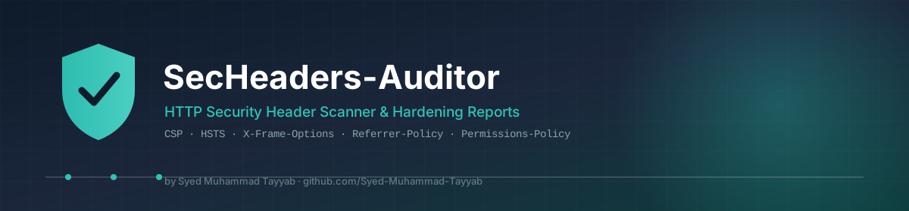

<div align="center">




### 🛡️ Developed by [Syed Muhammad Tayyab](https://github.com/Syed-Muhammad-Tayyab)


<br/>


</div>

<div align="center">


</div>

> ### ⚠️ Usage Notice — Please Read
> This tool scans **publicly served HTTP response headers** — the same thing your browser receives on every page load. It does not probe, brute-force, or exploit anything.
>
> 🚫 **Do not copy this repository and re-publish it as your own project.** You're welcome to use it, learn from it, and link back to it — just don't re-upload it under your own name/profile.
>
> Always get permission before running automated scans against infrastructure you don't own, even passive ones like this — some organizations still treat unsolicited scanning as unwanted traffic.

---

## 📜 Table of Contents

- [About](#-about)
- [How Scoring Works](#-how-scoring-works)
- [Headers Checked](#-headers-checked)
- [Project Structure](#-project-structure)
- [Getting Started](#-getting-started)
- [Usage](#-usage)
- [Example Output](#-example-output)
- [Sample Report Formats](#-sample-report-formats)
- [CI/CD Integration](#-cicd-integration)
- [Roadmap](#-roadmap)
- [Contributing](#-contributing)
- [License](#-license)
- [Contact](#-contact)

<div align="center">


</div>

## 📖 About

**SecHeaders-Auditor** is a command-line tool that fetches a website's HTTP response headers and scores them against a set of well-known web-security best practices (CSP, HSTS, clickjacking protection, MIME-sniffing protection, and more). It flags what's missing, what's weakly configured, and what's leaking implementation details — then hands you a console report, a JSON report for tooling, or a standalone HTML report you can share.

> 💡 **Why this matters:** Security headers are one of the highest-leverage, lowest-effort hardening steps a website can take — most take one line in a server config, yet a huge share of production sites still ship with none of them.

---

## ⚙️ How Scoring Works

```
┌────────────────┐     ┌──────────────────────┐     ┌─────────────────────┐
│  GET request    │ --> │  Evaluate each header │ --> │  Weighted score /   │
│  (headers only) │     │  against its rule      │     │  100 + letter grade │
└────────────────┘     └──────────────────────┘     └─────────────────────┘
```

Each header is worth points based on its real-world impact — a missing **Content-Security-Policy** costs more than a missing **Cross-Origin-Resource-Policy**, because CSP is the primary defense against XSS.

| Grade | Score Range |
|---|---|
| 🟢 **A+** | 90–100 |
| 🟢 **A** | 80–89 |
| 🔵 **B** | 70–79 |
| 🟡 **C** | 55–69 |
| 🟠 **D** | 40–54 |
| 🔴 **F** | 0–39 |

A header isn't just checked for *presence* — weak values are caught too (e.g. an `X-Frame-Options` set to something other than `DENY`/`SAMEORIGIN`, or a `Strict-Transport-Security` with too short a `max-age`).

---

## 🔎 Headers Checked

| Header | Points | Severity | Protects Against |
|---|---|---|---|
| `Content-Security-Policy` | 25 | 🔴 Critical | Cross-site scripting (XSS), data injection |
| `Strict-Transport-Security` | 20 | 🔴 Critical | SSL-stripping, protocol downgrade attacks |
| `X-Frame-Options` | 15 | 🟠 High | Clickjacking |
| `X-Content-Type-Options` | 10 | 🟡 Medium | MIME-sniffing attacks |
| `Referrer-Policy` | 10 | 🟡 Medium | Referrer/URL information leakage |
| `Permissions-Policy` | 10 | 🟡 Medium | Unauthorized use of camera/mic/geolocation |
| `Cross-Origin-Opener-Policy` | 5 | 🟢 Low | Cross-origin window attacks (Spectre-class) |
| `Cross-Origin-Resource-Policy` | 5 | 🟢 Low | Cross-origin resource leakage |

Also flagged — **information-disclosure headers** that shouldn't be present at all:

| Header | Why It's Flagged |
|---|---|
| `Server` | Reveals web server software/version |
| `X-Powered-By` | Reveals backend framework/version |
| `X-AspNet-Version` | Reveals ASP.NET version |

---

## 🗂️ Project Structure

```
SecHeaders-Auditor/
├── secheaders/
│   ├── __init__.py
│   ├── rules.py          # Header rule definitions, points, and validators
│   ├── scanner.py         # Fetches headers and evaluates them against rules.py
│   ├── report.py          # Console / JSON / HTML report rendering
│   └── cli.py              # Command-line entrypoint
├── assets/
│   ├── banner.svg / banner.png
│   ├── avatar.svg / avatar.png
│   └── divider.svg
├── docs/
│   └── scoring-methodology.md   # Why each header is weighted the way it is
├── requirements.txt
├── setup.py
├── README.md
└── LICENSE
```

---

## 🚀 Getting Started

### Prerequisites
- Python 3.9+
- Internet access (to fetch the target's headers)

### Installation

```bash
git clone https://github.com/Syed-Muhammad-Tayyab/SecHeaders-Auditor.git
cd SecHeaders-Auditor

python -m venv venv
source venv/bin/activate        # Windows: venv\Scripts\activate

pip install -r requirements.txt
# Optional: install as a CLI command
pip install -e .
```

---

## 🖥️ Usage

```bash
# Basic scan
python -m secheaders.cli example.com

# Or, if installed via setup.py:
secheaders example.com

# Export a JSON report (for tooling/automation)
secheaders example.com --json report.json

# Export a shareable HTML report
secheaders example.com --html report.html

# Fail with exit code 1 if score is below a threshold (handy for CI)
secheaders example.com --fail-under 70

# Skip TLS verification (self-signed certs, internal targets)
secheaders internal.example.com --insecure
```

---

## 📟 Example Output

```
$ secheaders example.com

SecHeaders-Auditor Report
--------------------------------------------------
Target:      example.com
Final URL:   https://example.com/  (after redirects)
Status Code: 200
Score:       35 / 100
Grade:       F
--------------------------------------------------

Header Findings
  [MISS] Content-Security-Policy  (+0/25 pts, critical)
         current: (not set)
         recommended: default-src 'self'; script-src 'self'; object-src 'none'
         why: Restricts which sources scripts, styles, and other resources may load from — the primary defense against XSS.
  [PASS] Strict-Transport-Security  (+20/20 pts, critical)
  [PASS] X-Frame-Options  (+15/15 pts, high)
  [MISS] X-Content-Type-Options  (+0/10 pts, medium)
  ...

Information Disclosure
  [LEAK] Server: nginx/1.18.0
         why: Reveals web server software/version — aids attacker fingerprinting.
  [LEAK] X-Powered-By: PHP/7.4.3
         why: Reveals backend framework/version — aids attacker fingerprinting.
```

---

## 📄 Sample Report Formats

| Format | Flag | Use Case |
|---|---|---|
| **Console** | *(default)* | Quick manual checks, colored pass/weak/miss output |
| **JSON** | `--json report.json` | Feed into dashboards, scripts, or other tooling |
| **HTML** | `--html report.html` | Share a clean, standalone report with a team or client |

---

## 🔗 CI/CD Integration

Use `--fail-under` to gate a deployment pipeline on header hygiene:

```yaml
# Example GitHub Actions step
- name: Audit security headers
  run: |
    pip install -r requirements.txt
    python -m secheaders.cli https://staging.example.com --fail-under 70
```

A score below the threshold exits non-zero, failing the build.

---

## 🗺️ Roadmap

- [x] Core header scanning + weighted scoring
- [x] Console, JSON, and HTML reports
- [x] CI-friendly `--fail-under` exit codes
- [ ] Batch mode — scan a list of domains from a file
- [ ] Historical tracking — diff a score against a previous scan
- [ ] Cookie security flag checks (`Secure`, `HttpOnly`, `SameSite`)
- [ ] Browser extension companion

---

## 🤝 Contributing

1. Fork the repo
2. Create your feature branch (`git checkout -b feature/AmazingFeature`)
3. Commit your changes (`git commit -m 'Add AmazingFeature'`)
4. Push to the branch (`git push origin feature/AmazingFeature`)
5. Open a Pull Request

---

## 📄 License

Distributed under the **MIT License**. See [`LICENSE`](LICENSE) for details.

---

## 📬 Contact

<div align="center">

**Syed Muhammad Tayyab**

[](https://github.com/Syed-Muhammad-Tayyab)

⭐ **If this project helped you, consider giving it a star!** ⭐


</div>
